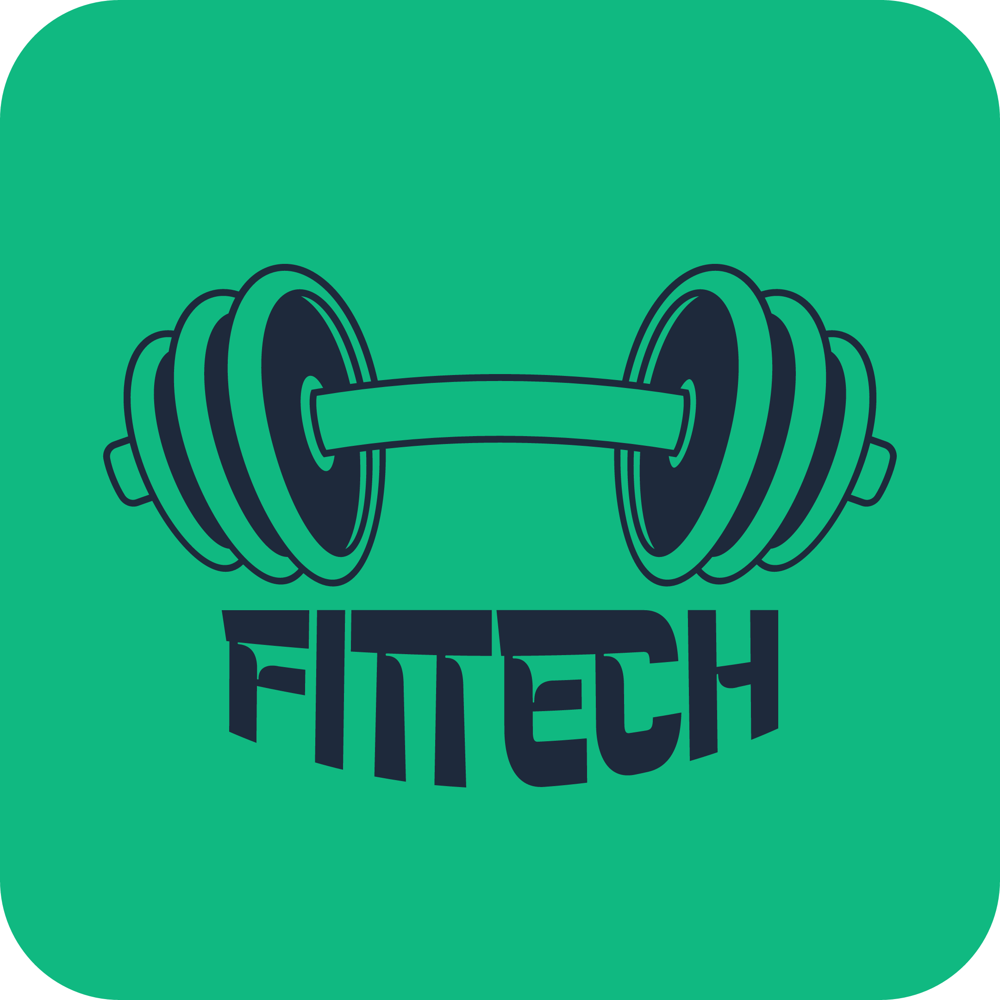

<p align="center">
  
</p>

<h1 align="center">FitTech</h1>

<p align="center">
  <b>Multi-Tenant Fitness SaaS Platform</b><br/>
  Operations, members, coaches, classes, payments, inventory, and AI-powered coaching in one place.
</p>

<p align="center">
  
  
  
  
</p>

---

**FitTech** is a multi-tenant SaaS platform that gives gym brands a single place to run operations, members, coaches, classes, payments, inventory, and AI-powered coaching. The repository bundles every surface of the product—Django backend, React/Next.js dashboards, and two Flutter apps (member + coach)—along with tooling to run the stack locally with one command.

## Highlights

- **Tenant-aware architecture** with brand, gym, moderator, coach, and member roles enforced by PostgreSQL Row-Level Security.
- **Scheduling & course booking** including waitlists, attendance tracking, reminders, and paid/free flows handled via FitCash wallet or Chargily checkout.
- **Wallet & payments** featuring deposits, refunds, withdrawals, invoicing, and reconciliation support for both online and cash transactions.
- **AI services** for nutrition tracking, coaching, analytics insights, and future Reflexion-style critique loops.
- **Operations tooling** such as equipment maintenance, inventory forecasting, chat, notifications, and dashboards tailored per role.
- **Developer-friendly setup** using `run_all.sh` to start backend, frontend, Ngrok tunnel, and both Flutter apps in one go (with logs stored in `.logs/`).

## Tech Stack

| Layer | Technologies |
|-------|--------------|
| Backend | Django, Django REST Framework, Celery, Redis, PostgreSQL (RLS), Docker Compose |
| Web Dashboard | Next.js (App Router), TypeScript, Tailwind CSS, Zustand/React Query-style stores |
| Mobile Apps | Flutter 3.x (member app + dedicated coach app), Riverpod, shared design system |
| AI & Analytics | Python services, RAG pipelines, Qwen2-VL vision integration, forecasting models |
| Tooling | Ngrok auto-tunnel, custom scripts, GitHub-ready docs, Swagger/OpenAPI |

## Repository Structure

```
FitTech/
├── assets/           # Logo and branding files
├── backend/          # Django project: auth, scheduling, payments, AI, notifications, etc.
├── frontend/         # Next.js dashboard for admins, moderators, superadmins
├── mobile/
│   ├── fittech/      # Flutter member application
│   └── fittech coach/# Flutter coach-facing application
├── anotherpresentation/  # HTML presentation deck (architecture, benchmarks, UML)
├── run_all.sh        # Starts DB, backend, tunnel, frontend, and both Flutter apps
├── stop_all.sh       # Gracefully stops everything started by run_all.sh
├── install.sh        # Optional helper for first-time dependency setup
├── .logs/            # Aggregated logs when services run locally
├── RUNALL.md         # Extended documentation for the orchestration script
├── SUBSCRIPTION_IMPLEMENTATION_GUIDE.md  # Business rules for subscription flows
├── LICENSE           # MIT License
└── README.md         # You are here
```

## Getting Started

### Prerequisites

- Docker + Docker Compose
- Python 3.11 virtual environment (recommended via `backend/.venv`)
- Node.js 18+ (for the Next.js dashboard)
- Flutter 3.19+ SDK and device/emulator for the mobile apps
- Ngrok account (optional—`run_all.sh` auto-configures if credentials are available)

### Quick Start (All Services)

```bash
# Clone & enter the repo
git clone https://github.com/AbdelbassetZrd/FitTech-Multi-Tenant-Fitness-SaaS-Platform.git
cd FitTech-Multi-Tenant-Fitness-SaaS-Platform

# Ensure helper scripts are executable
chmod +x run_all.sh stop_all.sh

# Launch database, backend API, Ngrok tunnel, frontend, and both Flutter apps
./run_all.sh
```

What you get:

- 🐘 **MySQL/PostgreSQL container** (depending on configuration) with seeded schemas
- 🐍 **Django backend** at http://127.0.0.1:8000 and Swagger docs at `/swagger/`
- 🌐 **Ngrok tunnel** (URL recorded in `.logs/ngrok_url.txt` and injected into Flutter constants)
- ⚛️ **Next.js dashboard** at http://localhost:3000
- 📱 **Flutter FitTech member app** development server
- 🧑‍🏫 **Flutter coach app** development server

Logs for each process are tailed into `.logs/` while individual terminal windows stay open for interactive output.

To stop everything:

```bash
./stop_all.sh
```

### Manual Service Control

If you prefer to run pieces independently:

1. **Database** – `docker-compose -f backend/docker-compose.yml up mysql`
2. **Backend** – `cd backend && source .venv/bin/activate && python manage.py runserver`
3. **Frontend** – `cd frontend && pnpm install && pnpm dev`
4. **Mobile apps** – `cd mobile/fittech && flutter run` (and similarly for the coach app)

Refer to `RUNALL.md` for advanced script flags, environment variable expectations, and troubleshooting tips.

## Key Domains

### Backend Highlights
- Access control with granular brand/gym roles and JWT auth
- FitCash wallet, Chargily integration, cash ledger, and subscription management
- Course scheduling, waitlist promotion, attendance tracking, and reminder tasks
- AI modules for nutrition logging, coaching prompts, analytics snapshots, and churn forecasting
- Celery workers for asynchronous jobs, Redis-backed caching, and notification pipelines

### Web Dashboard (Next.js)
- Role-aware dashboards (superadmin, brand admin, moderator)
- Analytics panels, churn/forecast insights, revenue and FitCash reporting
- CRUD interfaces for members, staff, classes, rooms, equipment, shop inventory, and orders
- Integrated with backend APIs via typed clients and shared utility layer

### Mobile Apps (Flutter)
- **Member app**: onboarding, gym switcher, course booking, wallet, AI coach, shopping flows
- **Coach app**: class rosters, attendance, member insights, communication tools
- Shared configuration with automatic Ngrok update for local API access

## Documentation & Resources

- `RUNALL.md` – detailed explanation of orchestration scripts and environment variables
- `SUBSCRIPTION_IMPLEMENTATION_GUIDE.md` – business logic for membership plans and billing
- `anotherpresentation/FitTech_PFE_presentation.html` – interactive deck containing diagrams, benchmarks, and architecture notes
- Backend Swagger UI at `http://127.0.0.1:8000/swagger/` after running the backend

## Team

FitTech is developed by students of **ESI SBA** (École Supérieure en Informatique, Sidi Bel Abbès):

| Name |
|------|
| Abdelbasset Zerradi |
| Ibrahim Oueld Mohammed |
| Walid Hadjbouziane |
| Badis Kherarba |
| Islam Touil |
| Ghalem |

## Contributing & Support

1. Fork the repository and create feature branches per domain (`feature/backend-course-waitlist`, etc.).
2. Follow existing style guides: Django apps use DRF conventions, frontend uses ESLint/Tailwind style rules, Flutter uses Riverpod architecture.
3. Run linters/tests before opening PRs (`python manage.py test`, `pnpm lint`, `flutter analyze`).
4. Document architectural decisions in the presentation deck or dedicated docs to keep the knowledge base aligned.

For questions or onboarding help, review the presentation deck and domain-specific docs listed above—they explain how components connect and the reasoning behind major engineering decisions.

## License

This project is licensed under the [MIT License](LICENSE).
© 2026 The FitTech team — ESI SBA.
